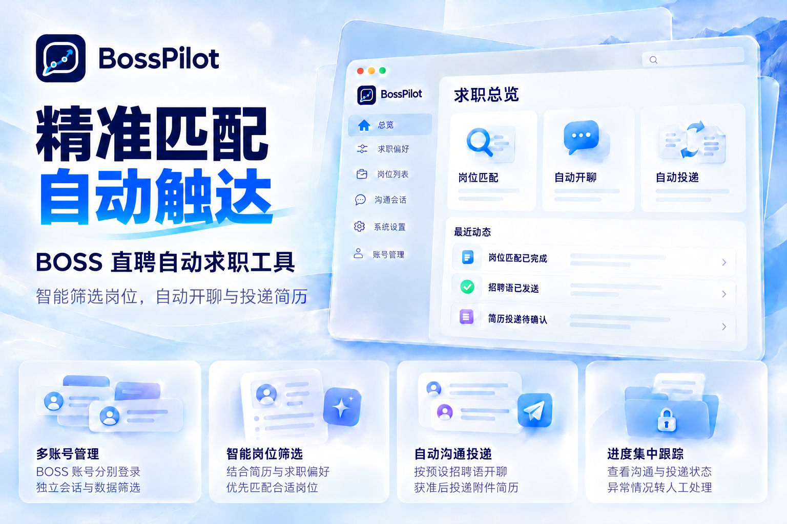

# BossPilot

BossPilot 是面向 BOSS 直聘的原生 macOS 自动求职工具。根据简历与求职偏好筛选岗位，自动发起沟通、按条件投递简历，将重复操作交给后台任务，将沟通与投递进度集中到一个工作台。



## 需求痛点

求职过程中，大量时间消耗在重复筛选、持续跟进与分散管理上。

- 筛选重复：反复搜索岗位、阅读描述、核对条件，再逐个发起沟通。
- 跟进繁琐：持续查看回复、处理简历索要，确认附件是否发出。
- 管理分散：多账号并行时，身份、会话与投递记录难以统一管理。

BossPilot 将上述步骤串成持续运行的流程：

- 自动推进：衔接岗位筛选、主动沟通与简历投递。
- 目标可控：由用户设定求职目标，维护招呼语与简历。
- 集中处理：聚焦有效回复与需要人工判断的事项。

## 核心功能

| 能力 | 功能 |
| --- | --- |
| 智能筛选 | 结合简历画像、岗位、城市、薪资与排除条件，评估岗位匹配度 |
| 自动沟通 | 使用 BOSS 账号预设招呼语开聊，按额度与间隔推进 |
| 自动投递 | 识别简历索要与同意信号，按条件提交附件简历并确认结果 |
| 多账号管理 | 扫码登录、独立会话、账号命名与数据筛选 |
| 进度跟踪 | 集中查看岗位、会话、投递状态和人工待办 |
| 运行保护 | 外发去重、低频调度、关键记录持久化与风险冷却 |

自动沟通使用预设招呼语，不自动发送任意文字回复。投递附件来自对应 BOSS 账号；本地导入简历用于分析。具体条件见 [自动沟通与简历投递](docs/核心功能/自动沟通与简历投递.md)。

## 工作流程

配置账号与目标 → 检索与匹配 → 自动开聊 → 同步消息 → 按条件投递 → 跟踪结果。

外发前重新核对求职要求、账号、额度和去重记录；结果未知时核对历史，不自动重发。需要用户判断或本人验证的情况交由人工处理。

## 系统架构

应用采用单机桌面架构：SwiftUI 工作台承载操作，控制器协调账号、任务与智能引擎，AppStore 管理业务状态，平台服务连接 BOSS 和 Codex CLI。详见 [系统架构与技术选型](docs/架构设计/系统架构与技术选型.md)。


## 快速开始

### 环境要求

macOS 14+、Swift 5.10+ 及可用的 macOS SDK。智能引擎需要已安装的 Codex CLI，并在应用内独立授权。

### 构建启动

在仓库根目录执行：

```bash
./script/build_and_run.sh
```

生成的应用位于 `dist/BossPilot.app`，使用本地 ad-hoc 签名。脚本会关闭旧实例并更新应用包，运行前请保存编辑内容。

构建、运行与调试统一使用 `build_and_run.sh`，完整命令见 [开发构建与调试验证](docs/开发维护/开发构建与调试验证.md)。

### 首次配置

1. 在“账号管理”扫码登录 BOSS 账号。
2. 在“求职偏好”导入 PDF、TXT 或 Markdown 简历，填写目标与排除条件并保存。
3. 在“系统设置 → 智能引擎”授权 Codex，配置模型、推理强度与数据授权。
4. 在 BOSS 官方端核对招呼语与附件简历，在“运行设置”确认消息同步和投递配置，再启动任务。

后台任务默认未启动，自动简历投递默认关闭。完整操作见 [使用指南与常见问题](docs/使用指南/使用指南与常见问题.md)。

## 使用边界

本项目为非官方工具，平台接口变化、限速与本人验证可能影响运行，节奏控制不保证账号免受限制。业务数据保存在本机；BOSS 交互与 Codex 分析仍需联网，分析数据按授权使用。

## 项目文档

| 分类 | 入口 |
| --- | --- |
| 使用指南 | [使用指南与常见问题](docs/使用指南/使用指南与常见问题.md) |
| 核心功能 | [自动沟通与简历投递](docs/核心功能/自动沟通与简历投递.md) · [智能引擎与数据隐私](docs/核心功能/智能引擎与数据隐私.md) |
| 架构设计 | [系统架构与技术选型](docs/架构设计/系统架构与技术选型.md) |
| 开发维护 | [开发构建与调试验证](docs/开发维护/开发构建与调试验证.md) |
