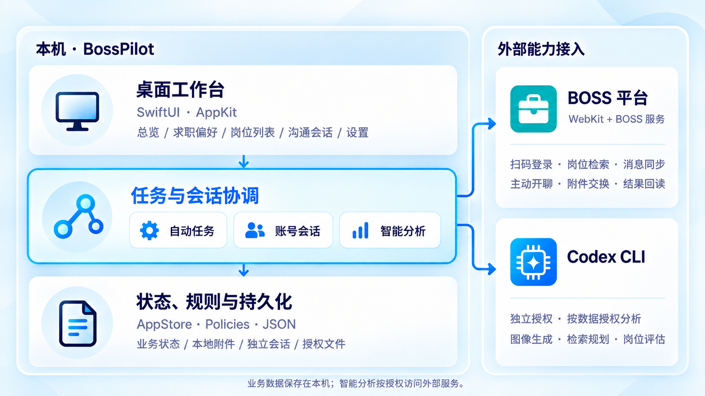

# 系统架构与技术选型

## 架构概览

BossPilot 是单机原生桌面应用。界面、任务调度、业务状态和文件存储均在本机运行，BOSS 平台服务与 Codex CLI 分别提供招聘平台接入和智能引擎能力，无需独立部署业务后端或数据库。

## 模块职责

| 模块 | 职责 |
| --- | --- |
| SwiftUI / AppKit | 页面、窗口、菜单与系统交互 |
| `BossAutomationController` | 检索、同步、开聊、投递与结果回读 |
| `BossSessionCoordinator` | 账号会话与生命周期管理 |
| `CodexController` | 画像、检索规划、评估与草稿任务协调 |
| `AppStore` | 业务状态更新与持久化协调 |
| `Policies` | 岗位规划、匹配、会话处理与选择规则 |
| `Services` | 平台请求、Codex 调用、文件与持久化 |

## 执行与状态管理

工作台保存求职目标与运行配置，任务控制器取得账号会话后推进岗位读取、详情补全与匹配评估。CodexController 协调分析任务，平台服务执行具体请求，结果逐步写入 AppStore。

外发前重新校验当前条件，并先持久化关键安全记录。提交后通过平台回执与会话历史确认结果；需要人工判断或本人验证时进入对应待办和暂停流程。规则细节见[自动沟通与简历投递](../核心功能/自动沟通与简历投递.md)。

账号使用独立 WebKit Profile 和会话文件；界面筛选只控制展示。多账号请求共用进程级节奏控制，普通状态保存使用后台队列，并与关键记录保持写入顺序。数据流向见[智能引擎与数据隐私](../核心功能/智能引擎与数据隐私.md)。

## 技术选型

| 领域 | 技术 |
| --- | --- |
| 语言与构建 | Swift 5.10、Swift Package Manager |
| 桌面界面 | SwiftUI、AppKit |
| 平台会话与网络 | WebKit、Foundation |
| 智能引擎 | Codex CLI |
| 文档读取 | PDFKit、Foundation |
| 状态存储 | JSON、本地文件、独立 WebKit Profile |
| 验证与诊断 | 内置自检、隔离 UI 预览、LLDB、系统日志 |

当前包清单无第三方 Swift 包依赖，系统版本与链接框架以 [Package.swift](../../Package.swift) 为准。

## 源码导航

| 目录 | 内容 |
| --- | --- |
| [App](../../Sources/App/) | 应用入口、场景与窗口生命周期 |
| [Views](../../Sources/Views/) | 页面、组件与界面集成 |
| [Controllers](../../Sources/Controllers/) | 任务、账号与智能引擎协调 |
| [Stores](../../Sources/Stores/) | 业务状态 |
| [Models](../../Sources/Models/) | 数据模型与配置 |
| [Policies](../../Sources/Policies/) | 业务规则 |
| [Services](../../Sources/Services/) | 外部接入与本地服务 |
| [Support](../../Sources/Support/) | 自检、预览与辅助工具 |
